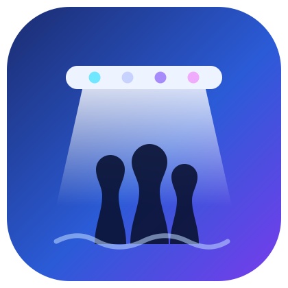

<p align="center">
  
</p>

<h1 align="center">Zetlight Horizon Aqua LED — Home Assistant integration</h1>

<p align="center">
  Local-LAN control of Zetlight reef / coral lights (the ones driven by the
  <b>Horizon Aqua</b> app) over UDP — <b>no vendor cloud, no Bluetooth</b>.<br>
  Developed and verified on the <b>M5-80M</b>; other Zetlight LED models using the
  same local UDP protocol may also work (untested — reports welcome).
</p>

<p align="center">
  
  
  
</p>

<p align="center">
  <b>English</b> · <a href="#中文">中文</a>
</p>

The integration talks directly to the light on your network — the same local
UDP channel the *Horizon Aqua* app uses:

```
Home Assistant  ──UDP :8855──►  light  (EE…CC request / DD…CC reply + XOR)
```

The full, device-verified protocol is documented in
[`docs/m5-light-protocol.md`](docs/m5-light-protocol.md); the feature backlog is
in [`docs/roadmap.md`](docs/roadmap.md).

## Features

| Feature | State |
| --- | --- |
| Turn on / off | ✅ Working (device-verified commands `0x1E` / `0x1F`) |
| Overall brightness | ✅ Working (device-verified command `0x13`) |
| Per-channel A/B/C/D dimming | ✅ Working (four `number` sliders, 0–100%) |
| Custom lightning effect | ✅ Working (`button.lightning`, tunable; white+blue flash) |
| Clock sync | ✅ Working (`0x03`; button + auto on setup) |
| Write daily schedule | ✅ `zetlight_led.set_schedule` (brightness + times verified; **overwrites stored program**) |
| Read daily schedule | ✅ `sensor.schedule` (5×4 brightness, raw %) |
| Reachability polling | ✅ Reads device status (`0x0C`) every 30 s |

### How on/off and brightness behave

- **On/off is optimistic.** The read command (`0x0C`) returns each channel's
  *setpoint*, which doesn't change when the lamp is switched off, so the entity
  tracks the last command it sent and assumes it took effect.
- **Brightness** scales Home Assistant's 0–255 to the device's 0–100 and applies
  it across all four channels. Each channel is also a separate `number` slider
  (`Channel A`/`B`/`C`/`D`). The overall light and the four sliders share one
  channel state: overall brightness follows the brightest channel, and setting
  it flattens all channels to the same level. Sliders are seeded from the
  device's reported setpoints on startup.
- **Real-time preview.** `0x13` sets the live output but does **not** write the
  device's stored time-curve program; at the next scheduled point the device
  reverts to its program.

### Lightning, clock & schedule

- **Lightning** — press `button.lightning` for a crisp white+blue flash (no
  purple afterglow). Tune it with the `Lightning flashes`, `Lightning intensity`
  and `Lightning flash duration` config numbers. It is built from live `0x13`
  frames and restores the previous levels, so it never touches the stored program.
- **Clock** — the device clock is set to Home Assistant's local time on setup,
  and `button.sync_clock` re-syncs on demand.
- **Schedule** — the `zetlight_led.set_schedule` service writes the full daily
  curve (5 time slots × 4 channels); the current curve is also read back on
  `sensor.schedule`. Brightness values are plain percentages (>100 is overdrive),
  times are 24h `HH:MM`, and the integration sends a START after writing to apply
  it. Both are verified on hardware. **It overwrites the device's stored
  program**, so set the values you actually want. Example:

  ```yaml
  service: zetlight_led.set_schedule
  data:
    start: "07:30"
    durations: [60, 120, 480, 120, 120]
    brightness:
      - [2, 18, 18, 2]
      - [4, 36, 24, 4]
      - [10, 90, 60, 10]
      - [6, 54, 36, 6]
      - [3, 27, 18, 3]
  ```

## Installation

### HACS (recommended)

1. In HACS, open the menu (⋮) → **Custom repositories**.
2. Add `https://github.com/rudyll/ha-zetlight-led` with category **Integration**.
3. Install **Zetlight Horizon Aqua LED**, then restart Home Assistant.

### Manual

Copy the integration into your Home Assistant config directory so you end up
with `config/custom_components/zetlight_led/manifest.json`, then restart Home
Assistant.

## Configuration

1. **Settings → Devices & Services → Add Integration → "Zetlight Horizon Aqua LED"**.
2. Pick a **discovered** light, or choose *Enter IP manually* and type its IP
   (port defaults to `8855`).

Home Assistant sends a read probe; a reply confirms reachability and auto-detects
the device code and name.

**Presets:** on the integration's **Configure** button, define named schedule
presets as YAML; apply them one tap from `select.preset`.

**Dashboard:** [`dashboards/reef-light.yaml`](dashboards/reef-light.yaml) is a
ready-made dashboard you can add as its own left-sidebar panel (instructions are
at the top of the file).

> **Tip:** give the light a **DHCP reservation** so its IP doesn't change. If
> Home Assistant and the light are on different VLANs, allow UDP to the light on
> port `8855`.

## Development

```bash
pip install pytest
pytest tests/
```

The tests cover frame building and parsing against real captured frames
(`OFF = EE000601023A011F21CC`, `ON = EE000601023A011E20CC`, the `0x13` brightness
frames for 10% and 100%, and a `0x0C` status reply) and have no Home Assistant
dependency.

## Protocol source

Everything here is derived from static analysis of the Horizon Aqua app plus
read-only probing and switch tests against the author's own device. See
[`docs/m5-light-protocol.md`](docs/m5-light-protocol.md).

## Sponsor

If this integration is useful to you, you can support its development via
[GitHub Sponsors](https://github.com/sponsors/rudyll). Sponsorship is entirely
voluntary — it is never required to use the integration, which stays fully
open-source.

---

<h2 id="中文">中文</h2>

<p align="center">
  通过本地局域网 <b>UDP</b> 控制积光 Zetlight 珊瑚灯（即 <b>Horizon Aqua</b> App 控制的那些灯）——
  <b>不走厂家云、不依赖蓝牙</b>。<br>
  在 <b>M5-80M</b> 上开发并实测；其他使用相同本地 UDP 协议的积光 LED 型号可能也能用（未实测，欢迎反馈）。
</p>

本集成直接在局域网里和灯通信，用的就是 *Horizon Aqua* App 那条本地 UDP 通道：

```
Home Assistant  ──UDP :8855──►  灯  (EE…CC 请求 / DD…CC 回包 + XOR)
```

完整且已实测的协议见 [`docs/m5-light-protocol.md`](docs/m5-light-protocol.md)，
功能待办清单见 [`docs/roadmap.md`](docs/roadmap.md)。

### 功能

| 功能 | 状态 |
| --- | --- |
| 开 / 关 | ✅ 可用（实测命令 `0x1E` / `0x1F`） |
| 整体亮度 | ✅ 可用（实测命令 `0x13`） |
| A/B/C/D 四通道独立调光 | ✅ 可用（4 个 `number` 滑杆，0–100%） |
| 在线状态轮询 | ✅ 每 30 秒读一次设备状态（`0x0C`） |
| 特效 / 日程 / 模式 | 🚧 计划中 —— 见 [roadmap](docs/roadmap.md) |

### 开关与亮度说明

- **开关是乐观状态。** 读命令（`0x0C`）回的是每通道的*设定值*，关灯时这几个字节
  不变，所以实体只记录"最后发出的命令"并假定其生效。
- **亮度**把 HA 的 0–255 换算到设备的 0–100，并同时作用于 4 个通道。每个通道也单独
  做成 `number` 滑杆（`Channel A`/`B`/`C`/`D`）。整体灯与 4 个滑杆共享同一份通道
  状态：整体亮度取"最亮通道"，设整体亮度则把 4 路拉平成同值。滑杆初值在启动时用设备
  回报的设定值做种子。
- **实时预览。** `0x13` 只改当前输出，**不会**写入设备存储的时间曲线程序；到下一个
  日程时间点，设备会按自己存的曲线把输出改回去。

### 安装

**HACS（推荐）**

1. HACS 菜单（⋮）→ **自定义存储库 / Custom repositories**。
2. 添加 `https://github.com/rudyll/ha-zetlight-led`，类别选 **Integration**。
3. 安装 **Zetlight Horizon Aqua LED**，然后重启 Home Assistant。

**手动**

把集成复制到 HA 配置目录，最终形成
`config/custom_components/zetlight_led/manifest.json`，然后重启 Home Assistant。

### 配置

1. **设置 → 设备与服务 → 添加集成 → “Zetlight Horizon Aqua LED”**。
2. 填灯的 **IP 地址**（端口默认 `8855`）。

HA 会发一个读探针，收到回包即确认可达，并自动识别设备码和名字。

> **建议：** 给灯做 **DHCP 保留地址**，避免 IP 变动。若 HA 和灯不在同一 VLAN，
> 需放行到灯 `8855` 端口的 UDP。

### 协议出处

本项目基于对 Horizon Aqua App 的静态反编译，加上对作者自有设备的只读探测与开关实测，
仅用于互操作 / 本地控制。详见 [`docs/m5-light-protocol.md`](docs/m5-light-protocol.md)。

### 赞助

如果这个集成对你有用，可以通过 [GitHub Sponsors](https://github.com/sponsors/rudyll)
支持开发。赞助完全自愿 —— 使用本集成永远不需要付费，项目保持完全开源。

---

<sub><b>Keywords:</b> Home Assistant, HACS, custom component, Zetlight, Horizon
Aqua, M5-80M, aquarium light, reef tank, coral light, saltwater, marine
aquarium, LED controller, 4-channel dimmer, local control, UDP, no cloud,
海缸, 珊瑚灯, 水族灯, 本地控制, 智能家居.</sub>
